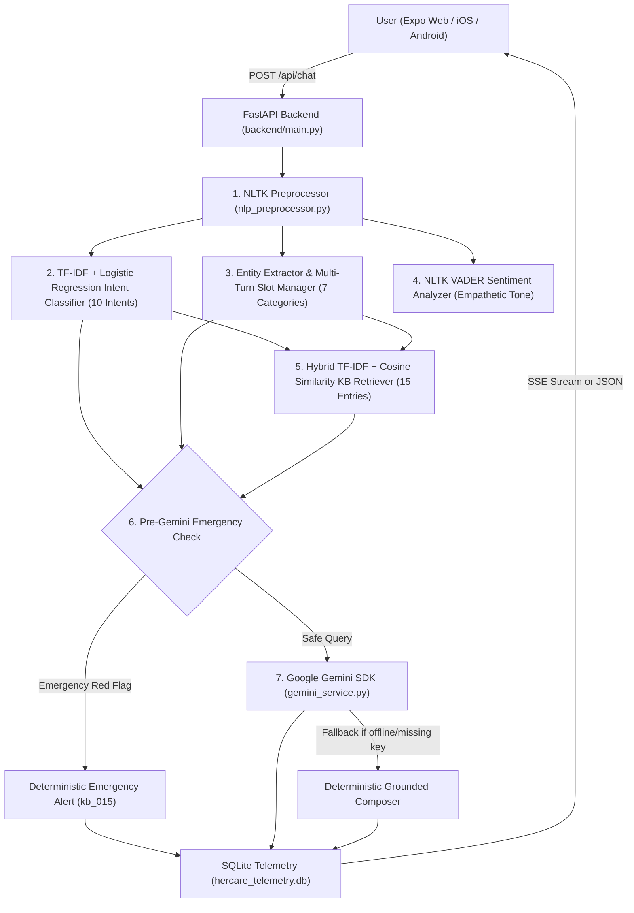

# 🌸 HerCare AI — Intelligent Women's Wellness Conversational Assistant

**HerCare AI** is a full-stack mobile and web women's wellness companion combining an **Expo React Native** frontend with a **Python FastAPI** conversational AI backend. Built for **UCS760 – Edge AI and Robotics: Reinforcement Learning & Conversational AI**, the system integrates a **7-stage classical NLP pipeline** (NLTK, scikit-learn TF-IDF, Logistic Regression, VADER sentiment analysis, multi-turn slot filling, and cosine-similarity knowledge-base retrieval) with **Google Gemini (`google-genai`)** for grounded, empathetic, and medically safe response generation.

---

## ✨ Key Features

### 📱 Mobile & Web Frontend (`artifacts/hercare/`)
- **Cycle Phase Ring & Tracker (`app/(tabs)/index.tsx`, `app/(tabs)/cycle.tsx`)**: Tracks menstrual cycle phases (*Menstrual*, *Follicular*, *Ovulatory*, *Luteal*), predicts upcoming periods, and logs flow intensity.
- **Mood & Symptom Logging (`app/(tabs)/mood.tsx`, `app/(tabs)/symptoms.tsx`)**: Logs daily emotional states and physical symptoms with severity ratings (*Mild*, *Moderate*, *Severe*).
- **Personalized Indian Wellness Plan (`POST /api/recommendations`)**: Generates 4 phase- and symptom-tailored cards (*Diet*, *Exercise*, *Self-Care*, *Supplement*) rooted in Indian nutrition and Ayurvedic practices.
- **HerCare AI Chat (`app/(tabs)/chat.tsx`)**: Real-time streaming conversational assistant supporting OpenAI-compatible Server-Sent Events (SSE), persistent multi-turn session IDs, automatic LAN/localhost backend discovery (`utils/api.ts`), and online/offline status indicators.

### 🧠 7-Stage NLP & Grounded Gemini Backend (`artifacts/hercare/backend/`)
1. **NLTK Text Preprocessing (`nlp_preprocessor.py`)**: Lowercasing, regex cleaning, domain synonym normalization, NLTK `word_tokenize`, stopword filtering (preserving clinical negations/intensifiers), and WordNet lemmatization (`WordNetLemmatizer`).
2. **Intent Classification (`intent_classifier.py`, `train_intent_model.py`)**: `TfidfVectorizer(ngram_range=(1, 2), sublinear_tf=True)` + `LogisticRegression(C=5.0, class_weight="balanced")` trained on **200 labelled queries** across **10 women's wellness intents**.
3. **Entity Extraction & Multi-Turn Slot Filling (`entity_extractor.py`)**: Extracts **7 entity categories** (`symptoms`, `severity`, `duration`, `mood`, `cycle_phase`, `medical_conditions`, `dietary_preference`, plus `cycle_day`) and maintains session state via `DialogueSlotManager`.
4. **Calibrated Sentiment Analysis (`sentiment_analyzer.py`)**: NLTK VADER (`SentimentIntensityAnalyzer`) augmented with women's wellness lexicon weights, classifying messages into `Positive`, `Negative`, or `Neutral` and selecting an empathetic tone directive.
5. **Hybrid Knowledge-Base Retrieval (`response_retriever.py`, `data/knowledge_base.json`)**: TF-IDF + cosine similarity over **15 curated, evidence-based entries** (with 30 cited clinical sources from WHO, ACOG, NIH, NHS, ICMR-NIN, OWH) enhanced by intent, entity, cycle-phase, and keyword boosts.
6. **Pre-LLM Emergency Medical Guardrail (`main.py`)**: Deterministic red-flag detector (e.g., soaking through pads hourly, fainting/dizziness with heavy bleeding, severe acute pelvic pain with fever) that executes **before** Gemini and forces urgent clinical triage (`kb_015`).
7. **Grounded Google Gemini Generation (`gemini_service.py`)**: Uses the official `google-genai` SDK (`HerCareGeminiService`) fed with all NLP signals and retrieved KB ground truth. Enforces strict non-diagnosis/non-prescription rules, verifies source URLs and safety disclaimers post-generation, and falls back gracefully to deterministic synthesis if the API key is missing, invalid, rate-limited, or offline.
8. **Privacy-Preserving SQLite Telemetry (`database.py`)**: Logs anonymized interaction metadata (session ID, timestamp, predicted intent, VADER sentiment scores, retrieved KB ID, emergency flag) without storing raw user messages or PII, exposed via `GET /api/metrics`.

---

## 🏗️ System Architecture



---

## 📂 Project Directory Structure

```text
Her-Care/
├── README.md
├── .gitignore
├── package.json
└── artifacts/
    └── hercare/
        ├── app/
        │   └── (tabs)/
        │       ├── index.tsx                  # Home screen + AI Wellness Plan
        │       ├── cycle.tsx                  # Menstrual cycle logger
        │       ├── mood.tsx                   # Mood tracker
        │       ├── symptoms.tsx               # Symptom & severity logger
        │       ├── chat.tsx                   # HerCare AI streaming chat screen
        │       └── profile.tsx                # Health & dietary profile
        ├── utils/
        │   └── api.ts                         # Auto-discovery of backend URL (Web & Expo Go)
        └── backend/
            ├── .env.example                   # Template for GEMINI_API_KEY & GEMINI_MODEL
            ├── requirements.txt               # Python dependencies
            ├── main.py                        # FastAPI server & 7-stage pipeline orchestration
            ├── nlp_preprocessor.py            # Stage 1: NLTK tokenization, stopwords, lemmatization
            ├── intent_classifier.py           # Stage 2: TF-IDF + Logistic Regression classifier
            ├── train_intent_model.py          # Model training & evaluation script
            ├── entity_extractor.py            # Stage 3: Entity extraction & DialogueSlotManager
            ├── sentiment_analyzer.py          # Stage 4: Calibrated NLTK VADER sentiment analysis
            ├── response_retriever.py          # Stage 5: Hybrid TF-IDF + cosine similarity KB retriever
            ├── gemini_service.py              # Stage 7: Official google-genai grounded service
            ├── database.py                    # SQLite persistence & /api/metrics aggregation
            ├── data/
            │   ├── intent_dataset.json        # 200 labelled utterances across 10 intents
            │   └── knowledge_base.json        # 15 curated clinical entries with 30 cited sources
            ├── models/
            │   ├── intent_classifier.joblib   # Trained scikit-learn pipeline artifact
            │   └── evaluation_metrics.json    # Saved holdout & 5-fold CV metrics
            ├── test_entity_slot_filling.py    # Multi-turn entity & slot-filling test suite
            ├── test_sentiment_analysis.py     # VADER emotional wellness test suite
            ├── test_response_retriever.py     # TF-IDF knowledge base retrieval test suite
            ├── test_chat_api.py               # End-to-end /api/chat & emergency test suite
            ├── test_sqlite_metrics.py         # SQLite telemetry & /api/metrics test suite
            └── test_gemini_integration.py     # Mocked + conditional live Gemini & recommendations tests
```

---

## 🚀 Setup & Installation Instructions

### 1. Backend Setup (Python FastAPI + NLP + Gemini)

Navigate to the application directory (`artifacts/hercare`):

```bash
cd artifacts/hercare
```

Create a Python virtual environment and install dependencies:

```bash
python3 -m venv backend/.venv
backend/.venv/bin/pip install -r backend/requirements.txt
```

Configure your Google Gemini API key (strictly on the backend):

```bash
cp backend/.env.example backend/.env
```

Open `backend/.env` and set your key (never commit `backend/.env` to Git):

```ini
GEMINI_API_KEY=your_gemini_api_key_here
GEMINI_MODEL=gemini-3.5-flash-lite
```

*(Note: If `GEMINI_API_KEY` is left empty, the backend automatically operates in deterministic grounded fallback mode using the local NLP pipeline and knowledge base.)*

Start the FastAPI backend server on port `5001`:

```bash
backend/.venv/bin/uvicorn backend.main:app --host 0.0.0.0 --port 5001 --reload
```

Verify the server is healthy:

```bash
curl http://localhost:5001/health
```

---

### 2. Frontend Setup (Expo React Native — Web, iOS, Android)

From the repository root (or `artifacts/hercare`), install JavaScript dependencies:

```bash
pnpm install
```

Start the Expo development server:

```bash
cd artifacts/hercare
npx expo start
```

- **Web**: Press `w` in the Expo terminal (automatically connects to `http://localhost:5001`).
- **Expo Go on Physical Phone**: Scan the QR code in Expo Go. Ensure your phone and computer are on the same Wi-Fi network, or set `EXPO_PUBLIC_API_URL=http://<YOUR_LAN_IP>:5001`.

---

## 🔌 Backend API Endpoints

| Method | Endpoint | Description |
| :--- | :--- | :--- |
| `GET` | `/health` | Health check returning service status, version, `gemini_configured`, and `gemini_model`. |
| `POST` | `/api/chat` | Executes the 7-stage NLP + Gemini pipeline. Supports `stream: true` (OpenAI-compatible `text/event-stream` SSE) and `stream: false` (full JSON diagnostic output). |
| `POST` | `/api/recommendations` | Generates 4 personalized Indian wellness cards (`diet`, `exercise`, `self-care`, `supplement`) for the Home screen based on cycle phase, symptoms, moods, and health profile. |
| `GET` | `/api/chat/session/{session_id}` | Inspects accumulated multi-turn conversation slots and intent history for a session. |
| `DELETE` | `/api/chat/session/{session_id}` | Clears multi-turn slot state for a session when the user resets chat history. |
| `GET` | `/api/metrics` | Returns anonymized SQLite telemetry (`total_chat_interactions`, `intent_distribution`, `sentiment_distribution`, `knowledge_base_distribution`, and `model_evaluation`). |

---

## 📊 NLP Pipeline Evaluation Metrics

### 1. Intent Classifier (`TF-IDF (1,2)-grams + LogisticRegression`)
- **Dataset**: 200 labelled women's wellness queries across **10 intents** (`backend/data/intent_dataset.json`, 75% stratified train = 150 samples, 25% stratified holdout test = 50 samples; metrics saved in `backend/models/evaluation_metrics.json`).

| Evaluation Protocol | Accuracy | Macro Precision | Macro Recall | Macro F1-Score |
| :--- | :---: | :---: | :---: | :---: |
| **Stratified Holdout Test Set (50 test samples)** | **86.00%** | **86.98%** | **86.00%** | **85.87%** |
| **5-Fold Stratified Cross-Validation (200 samples)** | **76.00%** | **78.02%** | **76.00%** | **75.82%** |

### 2. Component Benchmark Results
- **Sentiment Analyzer (`NLTK VADER` + domain calibration)**: **9 / 9 (100.0%)** accuracy across positive, negative, and neutral emotional wellness benchmarks.
- **Knowledge-Base Retriever (`TF-IDF + Cosine Similarity + Hybrid Boosts`)**: **12 / 12 (100.0%)** top-1 accuracy across in-domain queries and safe out-of-domain fallback (`kb_fallback`).
- **Pre-Gemini Emergency Safety Guardrail**: **100%** interception rate on red-flag queries (`kb_015`), guaranteed to execute before Gemini generation.

---

## 🧪 Running the Test Suites

Run all backend unit and integration test suites from `artifacts/hercare`:

```bash
cd artifacts/hercare

# 1. Train & evaluate the TF-IDF + Logistic Regression intent classifier
backend/.venv/bin/python -m backend.train_intent_model

# 2. Test entity extraction & multi-turn dialogue slot filling
backend/.venv/bin/python -m backend.test_entity_slot_filling

# 3. Test NLTK VADER sentiment analysis
backend/.venv/bin/python -m backend.test_sentiment_analysis

# 4. Test TF-IDF + cosine similarity knowledge-base retrieval
backend/.venv/bin/python -m backend.test_response_retriever

# 5. Test /api/chat endpoint (SSE streaming, multi-turn context, fallback, emergency check)
backend/.venv/bin/python -m backend.test_chat_api

# 6. Test SQLite telemetry persistence & GET /api/metrics
backend/.venv/bin/python -m backend.test_sqlite_metrics

# 7. Test Google Gemini integration (mocked client, emergency lock, error handling, recommendations, live API)
backend/.venv/bin/python -m backend.test_gemini_integration
```

---

## 🩺 Medical Safety Disclaimer

HerCare AI is an educational women's wellness and menstrual health companion created for academic demonstration (**UCS760**). It **never** diagnoses medical conditions, prescribes medications, or replaces professional clinical care. Always consult a qualified OB-GYN or healthcare provider for medical advice, diagnosis, or treatment.
